# Eziarr

**Find and grab what Radarr, Sonarr and Lidarr are still missing.**

Eziarr sits beside your *Arr stack. It lists every missing movie, episode and album in one place, keeps asking your indexers for them, and when the indexers come up empty it searches the places they don't look (Telegram channels, the Internet Archive and open directories), downloads what you pick, and hands the file to the right *Arr to import.

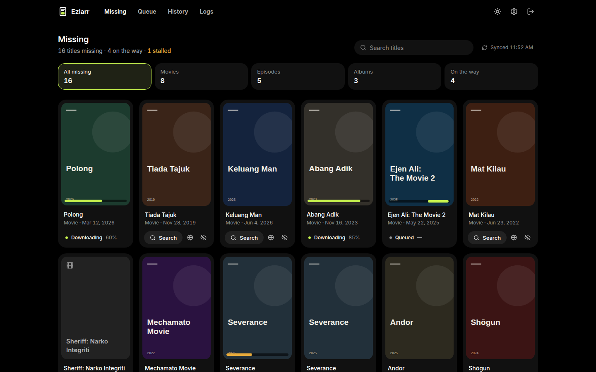

## ✨ Features

- **One wall for everything missing.** Radarr, Sonarr and Lidarr in a single poster wall, filtered by movies, episodes, albums or what's on its way, with a search box and a light/dark theme.
- **Live download state on every title.** Each poster shows whether it's downloading (with real progress), queued or stalled, and the title row says how many are missing, on the way and stalled.
- **Hunter.** A background worker re-searches old missing items on your indexers on a schedule.
- **Deep search** when the indexers fail:
  - **Indexers** via Prowlarr, with a **force grab** that temporarily lifts quality-profile, language and queue restrictions to push a release through.
  - **Telegram** (your own account over MTProto, so large files work).
  - **Internet Archive** and **open directories** (Apache/Nginx listings).
- **Auto-import.** Downloads are renamed the way the *Arr expects ("Title (Year).ext", "Series S01E02.ext") and imported with a targeted scan. For movies, Eziarr checks with Radarr that the file really landed before calling it done.
- **Keeps running when an *Arr doesn't.** If one *Arr is down, the rest of the wall still loads and the UI says which service isn't answering.

| | |
| --- | --- |
| 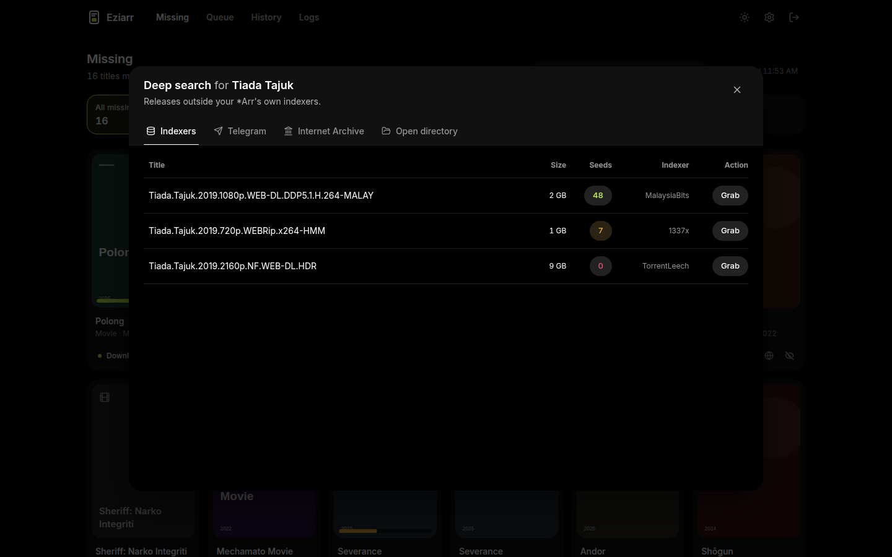 | 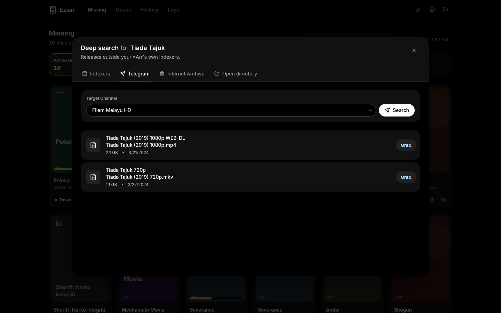 |
| 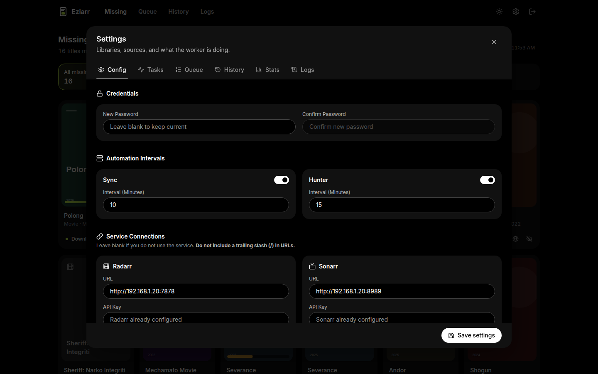 | 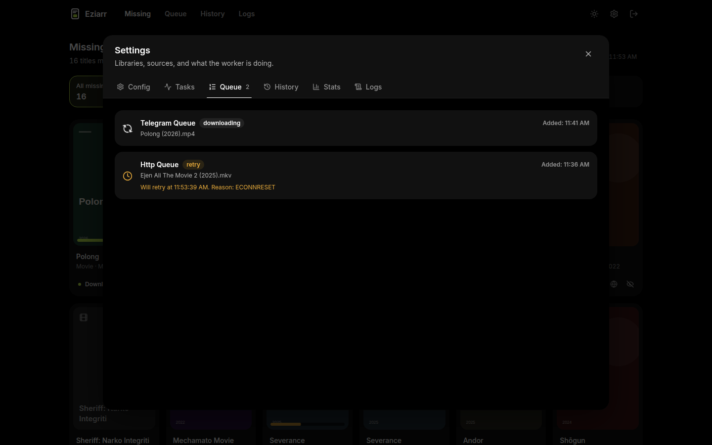 |

<details>
<summary>More screenshots</summary>

| | |
| --- | --- |
| 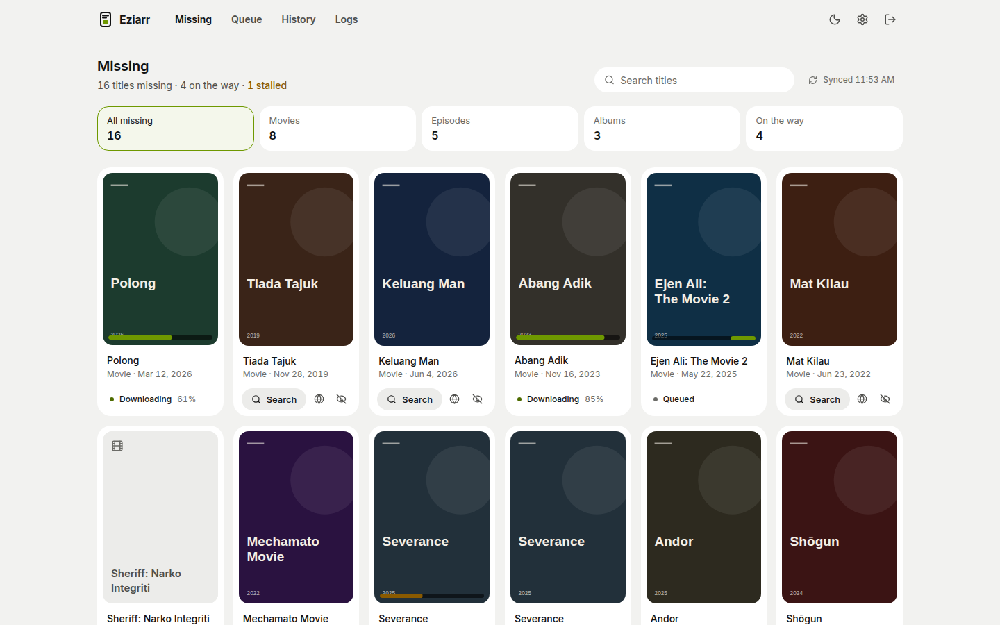 | 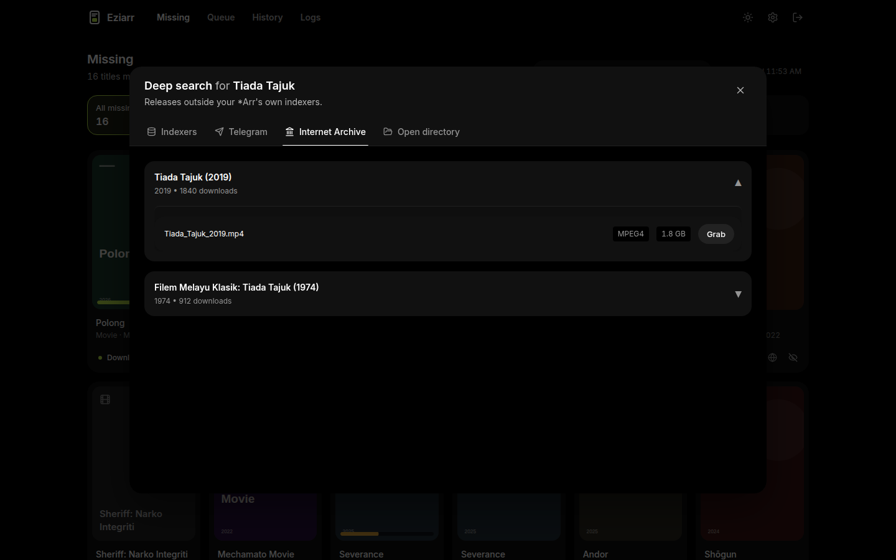 |
| 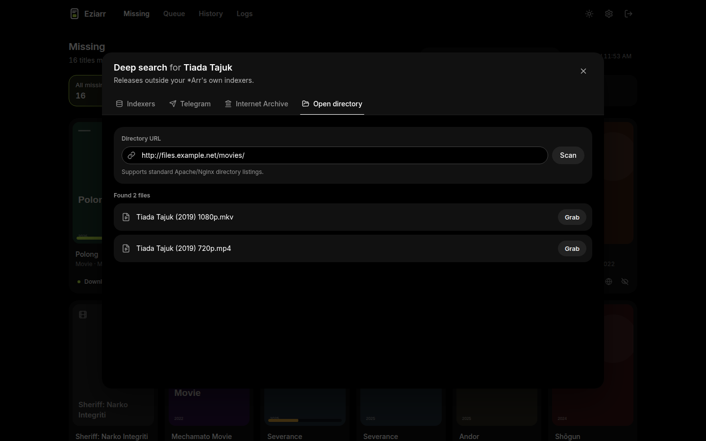 | 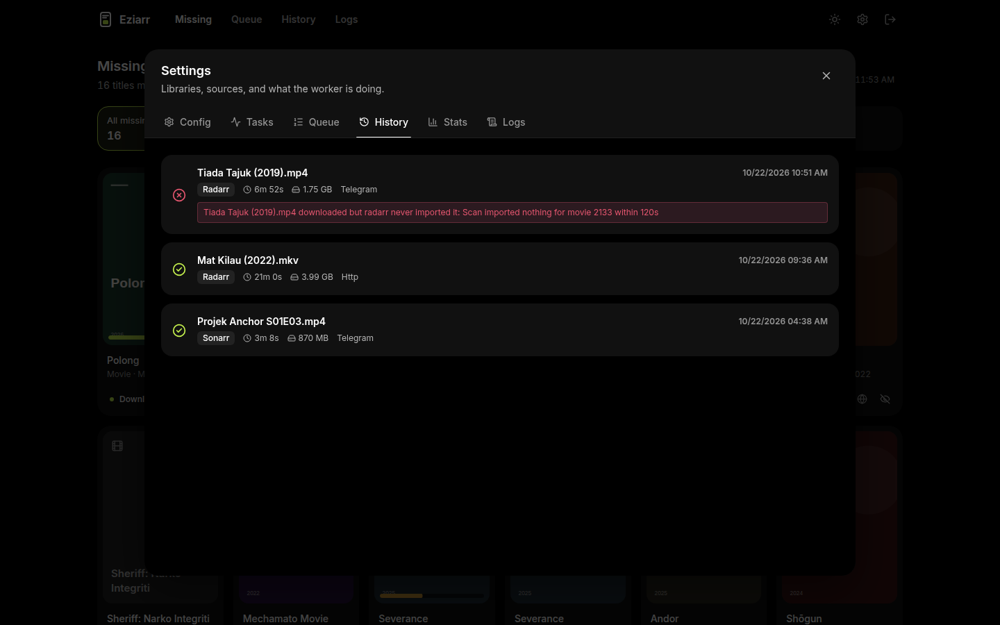 |
| 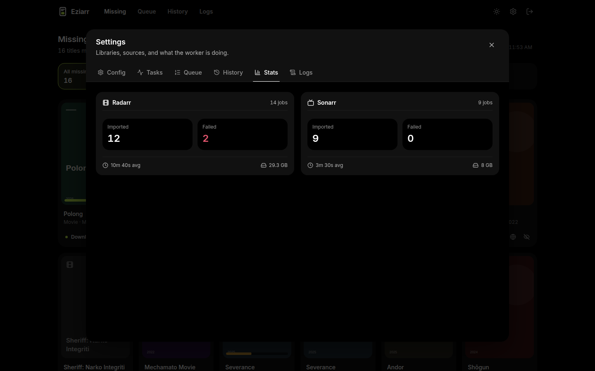 | 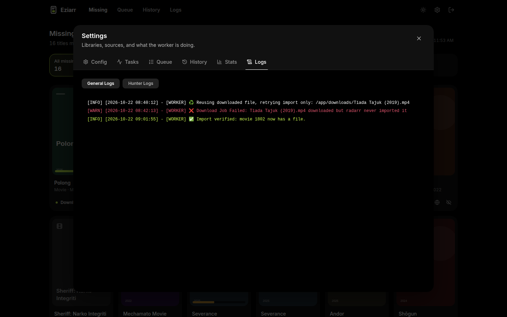 |
| 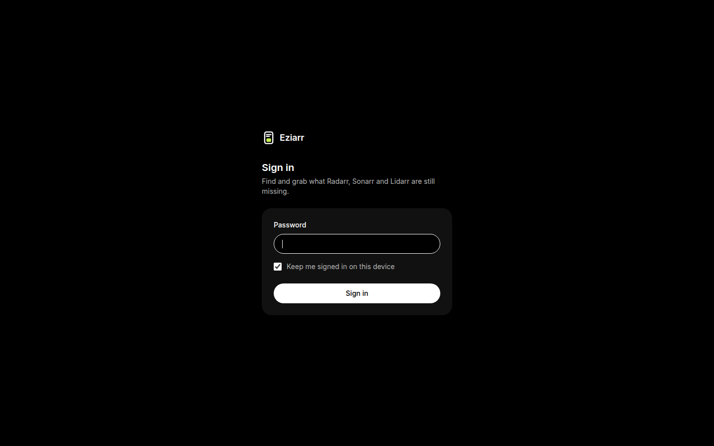 | 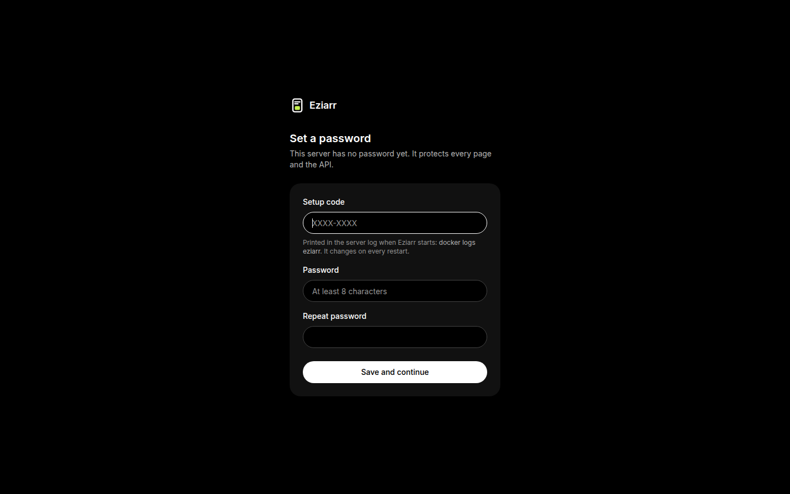 |

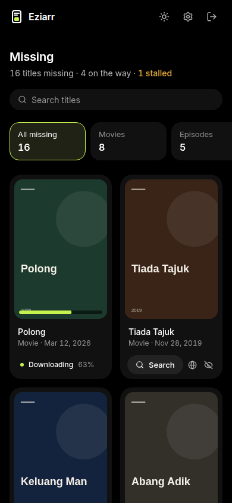

</details>

## 🚀 Getting started

### Docker (recommended)

```yaml
# docker-compose.yml
services:
  eziarr:
    image: calypso666/eziarr:latest
    container_name: eziarr
    ports:
      - "5000:5000"
    environment:
      - TZ=Asia/Kuala_Lumpur
      # - TRUST_PROXY=1        # only behind a reverse proxy, see below
    volumes:
      - ./eziarr/db:/app/db
      - ./eziarr/logs:/app/logs
      - /path/your/arrs/can/read:/app/downloads
    restart: unless-stopped
```

Then:

1. `docker compose up -d` and read the setup code from the log: `docker logs eziarr`.

   ```
   ┌───────────────────────────────────────────────┐
   │ First start: set the Eziarr password          │
   │ setup code  ZF38-JKBJ                         │
   └───────────────────────────────────────────────┘
   ```

2. Open `http://<your-server>:5000`, enter the code and choose a password (8+ characters).
3. In **Settings**, add Radarr, Sonarr and/or Lidarr (URL + API key; **Test** checks each one), and optionally Prowlarr and Telegram.

Eziarr then syncs your missing lists and starts hunting.

To skip the setup code, set `EZIARR_PASSWORD` (or `EZIARR_PASSWORD_FILE`) before the first start.

### From source

Requires [Bun](https://bun.sh) 1.4.

```bash
bun run install           # installs backend and frontend
bun run build:client      # builds the UI into client/
bun start                 # runs the server and worker under PM2
```

For development, see [CONTRIBUTING.md](CONTRIBUTING.md).

## ⚙️ Configuration

### Path mapping (Docker vs. your *Arrs)

Eziarr downloads into `/app/downloads` inside its container and then asks the *Arr to import that path. If the *Arr runs elsewhere (on the host, another container or a Windows box), it sees that folder under a different path, and the import finds nothing.

Mount a folder both can reach to `/app/downloads`, then set **Settings → Path Translation → *Arr Remote Path** to where the *Arr sees that same folder, for example `D:\Eziarr` or `/data/eziarr`. Eziarr rewrites the path (including slashes for Windows) before asking for the import.

### Environment variables

| Variable | Default | What it does |
| --- | --- | --- |
| `EZIARR_PASSWORD` / `EZIARR_PASSWORD_FILE` | unset | Sets the password on first start and skips the setup code. Ignored once a password exists. |
| `TRUST_PROXY` | `0` | How many reverse proxies sit in front of Eziarr. Set it (usually `1`) behind nginx, Traefik or Caddy; leave it unset otherwise. |
| `COOKIE_SECURE` | auto | Force `true`/`false` for the `Secure` cookie flag (auto: on when the request came in over HTTPS). |
| `JWT_SECRET` | generated | Session signing key; generated and stored on first start when unset. |
| `TZ` | `Asia/Kuala_Lumpur` | Time zone for logs and schedules. |
| `PORT` | `5000` | HTTP port. |
| `EZIARR_DB_DIR`, `EZIARR_LOG_DIR`, `EZIARR_DOWNLOAD_DIR` | `/app/db`, `/app/logs`, `/app/downloads` | Move the data directories (mainly for tests and non-Docker installs). |

Other settings (*Arr connections, Prowlarr, Telegram, sync and hunter intervals, path translation) live in the Settings screen.

### Limits and housekeeping

- A single download (HTTP or Telegram) is capped at **5 GiB**.
- Downloaded files that were never imported are swept after 24 hours; files a queued job still needs are kept.
- Logs rotate at 5 MB (three files kept): `general.log` (server), `worker.log` (worker) and `hunter.log`. The Logs tab shows the server and worker logs merged.
- Download history is kept indefinitely as an audit trail.

## 🔐 Security

- **Every page and API route requires a session**, except sign-in and first-start setup. A test walks the whole route table to keep it that way.
- **First start needs a one-time setup code** printed on the server console, so nobody who merely reaches a fresh install can claim it. It works once and changes on every restart until setup is done.
- **Sessions** are HttpOnly, `SameSite=Strict` cookies with a short-lived access token and a refresh token (1 day, or 30 with "keep me signed in"). Changing the password signs out every other browser and device.
- **Login is rate limited** to 10 attempts a minute per client. Behind a reverse proxy, set `TRUST_PROXY` so clients are told apart by their real address. Without it, `X-Forwarded-For` is ignored, because any client can send it.
- **Download sources are SSRF-guarded:** URLs must be http(s), may not resolve to private, loopback, link-local, multicast or reserved addresses (including IPv4 hidden inside IPv6 forms), are re-checked at connect time, and redirects aren't followed.
- Eziarr works over plain `http://` on a LAN. If you expose it to the internet, put it behind an HTTPS reverse proxy.

Found a security problem? Please report it privately; see [CONTRIBUTING.md](CONTRIBUTING.md#reporting-security-issues).

## ⬆️ Upgrading to 1.4

- **Behind a reverse proxy, set `TRUST_PROXY=1`.** Otherwise every client shares the proxy's login rate-limit bucket.
- **1.3 and earlier didn't enforce login on the API.** If your instance was reachable by people you don't trust, change the password after upgrading and check that the *Arr URLs in Settings are still yours.
- The worker now writes `worker.log` next to `general.log`.

The full list is in the [CHANGELOG](CHANGELOG.md).

## License

[MIT](LICENSE.md)
